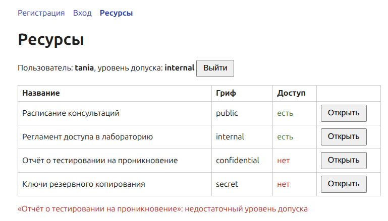

# ЛР 4. Регистрация пользователя и мандатная модель доступа

ПАСЗИ, вариант 1 — мандатная модель.

Веб-приложение с регистрацией, входом и разграничением доступа к ресурсам по уровням допуска. Пароли хранятся только в виде хэша Argon2id, проверка доступа выполняется на backend.

Стек: React + TypeScript (Vite), FastAPI, SQLAlchemy + Alembic, PostgreSQL 16, Docker Compose.

## Запуск

```bash
docker compose up --build
```

- приложение: http://localhost:8080
- Swagger: http://localhost:8000/docs
- PostgreSQL: localhost:5433 (не 5432, чтобы не конфликтовать с локально установленным PostgreSQL)

Без `.env` используются демонстрационные значения из `.env.example`. Для нормальной работы нужно создать `.env` со своими секретами:

```bash
cp .env.example .env
python3 -c "import secrets; print(secrets.token_hex(32))"
```

и заменить в нём `SECRET_KEY`, `POSTGRES_PASSWORD` и пароль в `DATABASE_URL`.

Миграции применяются при старте backend. Тесты:

```bash
docker compose exec backend pytest -v
```

## Структура

```
backend/
  alembic/versions/   миграции (0001 — users, 0002 — уровни допуска и ресурсы)
  app/
    access.py         правило мандатного доступа
    auth.py           текущий пользователь по JWT
    config.py         настройки из окружения
    db.py             подключение к БД
    logging_config.py JSON-логи
    main.py           эндпоинты
    models.py         таблицы users и resources
    schemas.py        валидация запросов и ответов
    security.py       Argon2id, JWT
  tests/
frontend/
  src/                api.ts, App.tsx, pages/
  nginx.conf          раздача статики и прокси /api на backend
docs/screenshots/
docker-compose.yml
.env.example
```

## Мандатная модель

Уровни по возрастанию: public, internal, confidential, secret.

У пользователя есть уровень допуска (`users.clearance`), у ресурса — гриф (`resources.classification`). Пользователь может прочитать ресурс, только если его допуск не ниже грифа (правило «нет чтения вверх» из модели Белла–ЛаПадулы):

```python
def can_read(clearance: str, classification: str) -> bool:
    return RANK[clearance] >= RANK[classification]
```

При регистрации пользователь получает уровень public. Повысить уровень может только администратор — в этой работе напрямую в БД:

```bash
psql -h localhost -p 5433 -U lab -d lab4 -c "UPDATE users SET clearance = 'internal' WHERE login = 'tania';"
```

Уровень берётся из БД при каждом запросе, поэтому изменение действует сразу, без повторного входа. Допустимые значения закреплены ограничениями CHECK. Миграция 0002 создаёт четыре тестовых ресурса, по одному на каждый уровень.

## API

- `POST /api/register` — регистрация. 201, 409 (логин занят), 422 (ошибка валидации)
- `POST /api/login` — вход, возвращает JWT. 200, 401
- `GET /api/me` — текущий пользователь и его допуск
- `GET /api/resources` — список ресурсов с признаком `allowed`
- `GET /api/resources/{id}` — содержимое ресурса. 200, 403 (недостаточный допуск), 404
- `GET /api/health` — проверка работоспособности

Без токена эндпоинты `/me` и `/resources` возвращают 401.

Требования при регистрации: логин 3–32 символа (латиница, цифры, `.`, `_`, `-`); пароль от 8 символов, с заглавной и строчной латинской буквой, цифрой и спецсимволом.

### curl

```bash
curl -i -X POST http://localhost:8000/api/register \
  -H "Content-Type: application/json" \
  -d '{"login":"tania","password":"Qwerty1!x"}'
# 201 {"message":"user создан"}
# повторно: 409 {"detail":"логин уже занят"}

curl -i -X POST http://localhost:8000/api/register \
  -H "Content-Type: application/json" \
  -d '{"login":"ab","password":"qwerty"}'
# 422 {"detail":"логин: от 3 до 32 символов, ...; пароль: минимум 8 символов, ..."}
```

Вход и запросы с токеном:

```bash
TOKEN=$(curl -s -X POST http://localhost:8000/api/login \
  -H "Content-Type: application/json" \
  -d '{"login":"tania","password":"Qwerty1!x"}' \
  | python3 -c "import sys, json; print(json.load(sys.stdin)['access_token'])")

curl -H "Authorization: Bearer $TOKEN" http://localhost:8000/api/me
# {"id":2,"login":"tania","clearance":"internal"}

curl -i -H "Authorization: Bearer $TOKEN" http://localhost:8000/api/resources/2
# 200, ресурс с грифом internal

curl -i -H "Authorization: Bearer $TOKEN" http://localhost:8000/api/resources/3
# 403 {"detail":"недостаточный уровень допуска"}
```

## Безопасность: что сделано

- пароли хэшируются Argon2id со случайной солью, параметры вынесены в конфигурацию (`ARGON2_TIME_COST`, `ARGON2_MEMORY_COST`, `ARGON2_PARALLELISM`);
- пароль не попадает ни в логи, ни в ответы сервера: обработчик ошибок 422 не возвращает присланные данные и логирует только имена полей;
- уникальный индекс на `login` защищает от дублей на уровне БД, в том числе при одновременных запросах;
- длина пароля ограничена 128 символами, чтобы нельзя было нагрузить сервер хэшированием огромных строк;
- доступ к ресурсам проверяется на backend, интерфейс только показывает результат;
- новый пользователь получает минимальный уровень допуска;
- ограничения CHECK в БД не дают записать несуществующий уровень;
- JWT подписан HS256, срок действия ограничен, при проверке разрешён только HS256;
- при входе с несуществующим логином пароль всё равно проверяется против фиктивного хэша, чтобы по времени ответа нельзя было понять, есть ли такой пользователь; сообщение об ошибке одинаковое;
- попытки доступа к ресурсам пишутся в журнал (`access_granted` / `access_denied`);
- backend в контейнере работает не от root;
- nginx не показывает свою версию и добавляет заголовки `X-Content-Type-Options`, `X-Frame-Options`, `Referrer-Policy`;
- секреты лежат в `.env`, который не попадает в репозиторий;
- `npm audit --omit=dev` не находит уязвимостей в зависимостях, которые попадают в сборку.

Что не сделано: токен хранится в localStorage (надёжнее HttpOnly cookie), нет ограничения частоты попыток входа, реализовано только правило чтения, уровни назначаются через БД без интерфейса администратора.

## Логи и тесты

Логи backend пишутся в JSON с уровнями INFO и ERROR (`docker compose logs backend`), например:

```
{"time": "...", "level": "ERROR", "message": "access denied", "event": "access_denied", "login": "tania", "clearance": "internal", "resource_id": 3, "classification": "confidential"}
```

Тестов 9, каждый на отдельной временной SQLite-базе: регистрация (успех, повторный логин, слабый пароль, пароль хранится как хэш) и доступ (разрешён, запрещён, флаги в списке, без входа, неверный пароль).

## Скриншоты



Остальные — в `docs/screenshots/`.

## Ветки и вклад

`main` — стабильная версия, `dev` — разработка, части работы делались в ветках `feature/backend-register`, `feature/mandatory-access`, `feature/frontend`, `docs/readme` и сливались в `dev`.

- Ларионова Татьяна — backend регистрации: модель users, валидация, хэширование Argon2id, логирование;
- Суриков Дмитрий — мандатная модель доступа: уровни допуска и ресурсы, миграции, вход по JWT, автотесты;
- Лысенкова Милена — frontend на React, сборка в Docker и nginx, docker-compose, README.
